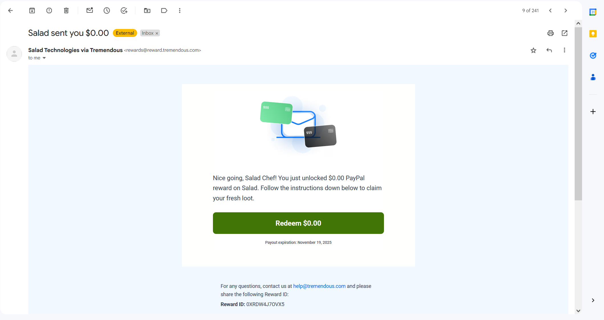
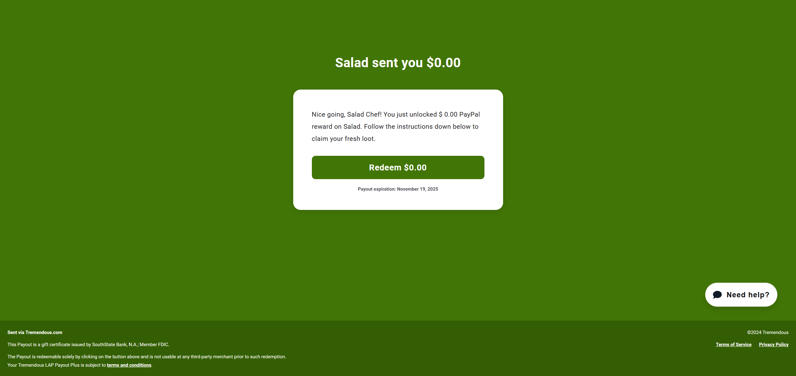
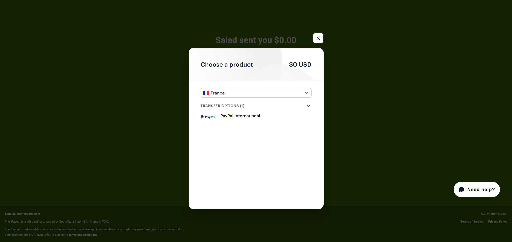
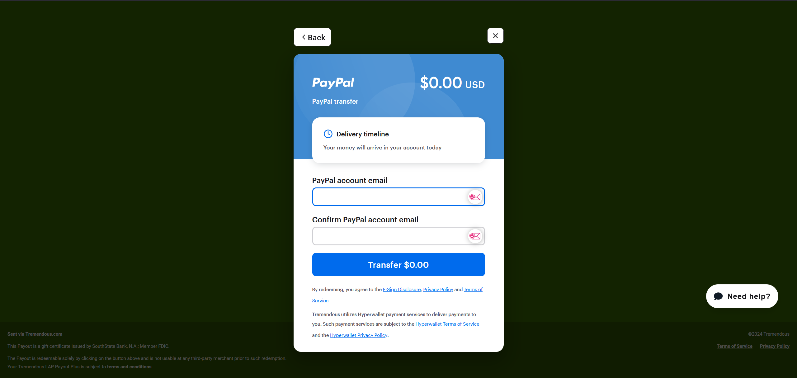
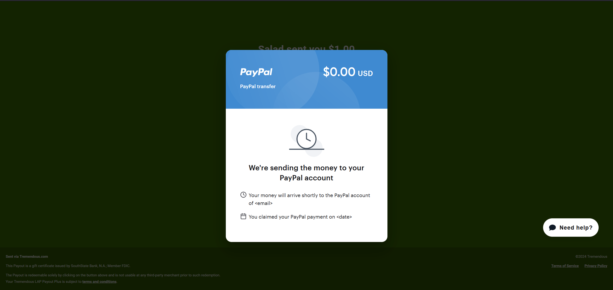

PayPal rewards let you move your Salad Balance to your own PayPal account in your home currency. Redeem them from the
[Storefront](https://salad.com/store/search?q=PayPal&size=n_20_n) like any other reward.

Before you redeem, make sure you are in one of the
[supported PayPal countries](/rewards/help/supported-paypal-countries): a reward redeemed from an unsupported country
may not be claimable, and [redemptions are final](/rewards/help/i-want-a-refund).

## How delivery works

There is no PayPal field in Salad. Shortly after you redeem, our reward partner Tremendous sends an email with a claim
link to the email address on your Salad account. You enter your PayPal email on that claim page, not in Salad, and
Tremendous sends the balance to that PayPal account.

## Claiming your PayPal reward

1. Open the inbox of your Salad account's email address and find the reward email (check spam too).

   

2. Click the redeem button in the email. It opens the claim page.

   

3. Click redeem on the claim page. A new window opens with the transfer options.

   

4. Select the country of your PayPal account, then pick the first transfer option. In most countries this is "PayPal
   International"; in the United States it is "PayPal USA".

   

5. Enter the email address linked to your PayPal account, check it carefully, and press **Transfer**.

   

Tremendous then processes the transfer. Allow up to 24 hours for the balance to arrive in your PayPal account.

## No email?

Follow the checklist in
[I redeemed a reward but haven't received it](/rewards/help/i-redeemed-a-reward-but-havent-received-it). Salad Support
can have the claim email resent, but cannot change the delivery method or pay out balance directly.

## Experiencing issues?

If the claim page gives an error, the transfer does not arrive after you pressed Transfer, or you entered the wrong
PayPal email, use the help link on the claim page to contact Tremendous. See
[Problems using a reward](/rewards/help/problems-using-a-reward) for what to send them and what to send Salad.
