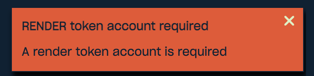

import { Tab, Tabs } from 'fumadocs-ui/components/tabs'
import { Step, Steps } from 'fumadocs-ui/components/steps'
import { Accordion, Accordions } from 'fumadocs-ui/components/accordion'

RENDER is a cryptocurrency token (the token of the Render Network) that you can redeem with your Salad Balance. It is
sent to a crypto wallet that you own, on the Solana network.

This guide takes you through the whole process, from creating a wallet to receiving your first RENDER. If you have never
used crypto before, follow the **Simple** tabs. If you already use Solana, the **Advanced** tabs have the short version.

## Before you start: is RENDER right for you?

RENDER takes more setup than a gift card. Read this first so there are no surprises:

- **You need a Solana wallet.** This is an app (usually on your phone) that holds your tokens. Salad cannot create one
  for you.
- **You need a small amount of SOL in that wallet first.** SOL is the Solana network's own currency. Your wallet needs
  around **0.01 to 0.02 SOL** to set itself up to receive RENDER (see
  [Step 3](#step-3-set-up-your-render-token-account)). You only do this once.
- **RENDER is not cash.** Its value goes up and down like any cryptocurrency. To turn it into regular money, you will
  usually need an account on a crypto exchange, and exchanges ask you to verify your identity (with an ID document)
  before you can withdraw to your bank. See [Turning RENDER into money](#turning-render-into-money).

If you would rather have something you can spend straight away, a gift card or
[PayPal](/rewards/redeeming-your-rewards/how-to-redeem-paypal) reward from the Storefront is simpler.

<Callout type="info" title="What you need">

1. A Solana wallet.
2. About 0.01 to 0.02 SOL in it.
3. A RENDER token account in that wallet (created once).
4. Your wallet address saved on your Salad account.

Steps 1 to 4 are a one-time setup. After that, redeeming RENDER is a single click.

</Callout>

<Steps>
<Step>

## Step 1: Get a Solana wallet

<Tabs groupId="render-guide" items={['Simple', 'Advanced']} persist>
<Tab value="Simple">

1. Install a Solana wallet app on your phone from the official App Store or Google Play listing. Popular choices are
   **Phantom** and **Solflare**. Both also exist as browser extensions if you prefer your PC.
2. Open the app and choose **Create a new wallet**.
3. The app shows you a **recovery phrase** (12 or 24 words). Write it down on paper and keep it somewhere safe.

<Callout type="warn" title="Your recovery phrase is your wallet">
  Anyone who has these words can take everything in the wallet, and if you lose them and your phone, the wallet is gone.
  Salad will never ask for your recovery phrase. Never type it into a website or send it to anyone, including someone
  claiming to be support.
</Callout>

</Tab>
<Tab value="Advanced">

Any self-custody Solana wallet works: a mobile or browser wallet, a hardware wallet, or a keypair created with the
Solana CLI (`solana-keygen new`). Do not use an exchange deposit address. See
[Can I use an exchange address?](#can-i-use-an-exchange-deposit-address)

</Tab>
</Tabs>

</Step>
<Step>

## Step 2: Add a little SOL to your wallet

Your wallet needs SOL to set up the RENDER token account in the next step. About **0.01 to 0.02 SOL** is enough. The
setup itself costs around 0.002 SOL and the rest covers network fees with room to spare.

<Tabs groupId="render-guide" items={['Simple', 'Advanced']} persist>
<Tab value="Simple">

There are three common ways to get SOL into your wallet:

- **Buy it in the wallet app.** Phantom and Solflare have a **Buy** button that lets you pay by card through a payment
  partner. The partner may ask you to verify your identity, and may have a minimum purchase amount.
- **Send it from a crypto exchange** where you already have an account. Withdraw SOL and paste your wallet's Solana
  address as the destination (see [Step 4](#step-4-save-your-wallet-address-on-salad) for how to copy it). Make sure the
  withdrawal network is **Solana**.
- **Ask a friend** who uses Solana to send you a small amount.

When it arrives, you will see your SOL balance on the wallet's home screen.

</Tab>
<Tab value="Advanced">

Fund the wallet with roughly 0.01 to 0.02 SOL. The token account rent is about 0.002 SOL (refundable if you later close
the account); the rest covers the transaction fee and any priority fee.

</Tab>
</Tabs>

</Step>
<Step>

## Step 3: Set up your RENDER token account

On Solana, a wallet needs a separate "token account" for each kind of token it holds. Salad can only send RENDER to a
wallet that already has a RENDER token account. If it does not have one, the redemption fails, your Salad Balance is
refunded automatically, and you see this message:



You only need to do this once per wallet.

<Tabs groupId="render-guide" items={['Simple', 'Advanced']} persist>
<Tab value="Simple">

The easiest way is to swap a small amount of your SOL into RENDER. Getting any RENDER creates the account automatically.

1. In your wallet app, tap **Swap**.
2. Choose **SOL** as the token you pay with.
3. Choose **RENDER** as the token you receive. Search for "RENDER" and pick the verified token (the one by Render
   Network). The correct token address is `rndrizKT3MK1iimdxRdWabcF7Zg7AR5T4nud4EkHBof`.
4. Swap a small amount of SOL, for example the equivalent of a dollar or less. Leave the rest of your SOL in the wallet
   for fees.
5. Confirm the swap. When it completes, **RENDER** appears in your wallet's token list. Your wallet is now ready.

</Tab>
<Tab value="Advanced">

Create the associated token account (ATA) for the RENDER mint on the wallet you will save on Salad:

```
spl-token create-account rndrizKT3MK1iimdxRdWabcF7Zg7AR5T4nud4EkHBof --owner <YOUR_WALLET_ADDRESS> --fee-payer <KEYPAIR>
```

Salad looks up any RENDER token account owned by your wallet, so an account created by a swap or by receiving RENDER
from elsewhere works too.

</Tab>
</Tabs>

</Step>
<Step>

## Step 4: Save your wallet address on Salad

1. In your wallet app, tap **Receive** (or tap your account name) and copy your **Solana** address. It is a long string
   of letters and numbers, such as `7xKX…9aBc`. Some wallets also show Ethereum or Bitcoin addresses; make sure you copy
   the one labelled **Solana**.
2. Go to your [Account Summary](https://salad.com/account/summary) on Salad.
3. Paste the address into the Solana wallet field and save.

<Callout type="error" title="Check the address before you redeem">
  If the address on your account is wrong, your RENDER is sent there, cannot be recovered, and is not refunded. Paste it
  rather than typing it, and compare the first and last few characters with your wallet app.
</Callout>

</Step>
<Step>

## Step 5: Redeem RENDER

1. Open the [RENDER reward](https://salad.com/store/search?q=RENDER&size=n_20_n) on the Salad Storefront.
2. Choose your amount. The exchange rate is shown at checkout.
3. Click **Buy Now** to redeem with your Salad Balance.
4. Your RENDER is sent to the wallet address on your account. Salad pays the network fee for this transfer, so it does
   not use any of your SOL.
5. You receive a confirmation email with your Solana transaction ID.

If a redemption fails for any reason, your Salad Balance is refunded to your account automatically.

</Step>
<Step>

## Step 6: Check that it arrived

Open your wallet app; the RENDER should appear in your token list within a few minutes. To see the transfer itself, open
the transaction link in your confirmation email, or paste the transaction ID into [solscan.io](https://solscan.io). In
most wallets you can also tap the RENDER transfer in your activity and choose **View on Solscan**.

</Step>
</Steps>

## Turning RENDER into money

RENDER stays in your wallet until you decide what to do with it. You can keep it, swap it for another token in your
wallet app, or sell it for regular money.

To sell it for money in your bank account:

1. Open an account on a crypto exchange that lists RENDER and **accepts RENDER deposits on the Solana network**. Most
   exchanges will ask you to verify your identity before you can deposit or withdraw. This is a legal requirement for
   them, not a Salad requirement.
2. In the exchange, find the deposit address for **RENDER** and select the **Solana** network.
3. In your wallet app, send your RENDER to that address. This needs a tiny amount of SOL for the network fee, which is
   why it is worth keeping a little SOL in your wallet.
4. Sell the RENDER on the exchange and withdraw the money to your bank.

<Callout type="warn">
  Sending RENDER on the wrong network, or to an exchange that does not support Solana deposits for RENDER, can lose the
  tokens. Always check the network on the exchange's deposit page first.
</Callout>

Some wallet apps also have a **Sell** or **Cash out** option through a payment partner. These work the same way: the
partner will ask you to verify your identity.

## Troubleshooting and questions

<Accordions type="single">
<Accordion title="I get &quot;RENDER token account required&quot; when I redeem" id="render-token-account-required">

Your wallet does not have a RENDER token account yet, so the redemption failed and your Salad Balance was refunded
automatically. Do [Step 3](#step-3-set-up-your-render-token-account) on the wallet whose address is saved on your Salad
account, then redeem again. If you already did Step 3, check that the address on your Salad account is the same wallet
you swapped in.

</Accordion>
<Accordion title="Why do I need SOL if Salad pays the transfer fee?" id="why-do-i-need-sol">

Salad pays the fee to send you RENDER. The SOL is only needed for two things you do yourself: creating the RENDER token
account once (Step 3), and later moving or swapping your RENDER.

</Accordion>
<Accordion title="My swap failed or says I don't have enough SOL" id="not-enough-sol">

Your wallet needs a little more SOL than the amount you are swapping, to pay for the token account and the fee. Swap a
smaller amount, or add a bit more SOL (around 0.01 to 0.02 SOL in total is plenty).

</Accordion>
<Accordion title="Can I use an exchange deposit address?" id="can-i-use-an-exchange-deposit-address">

We recommend a wallet you control. Exchange deposit addresses may not accept RENDER on Solana, may not have a RENDER
token account, and are controlled by the exchange rather than you.

</Accordion>
<Accordion title="I don't see RENDER in my wallet" id="dont-see-render">

Check the transaction ID from your confirmation email on [solscan.io](https://solscan.io). If it shows the transfer to
your address, the RENDER is there; some wallets hide tokens until you add or enable them in the token list. If the
address on Solscan is not yours, contact support.

</Accordion>
<Accordion title="What happens if I don't have a wallet saved on Salad?" id="no-wallet-saved">

The redemption fails and your Salad Balance is refunded. Add your address (Step 4) and try again.

</Accordion>
</Accordions>
