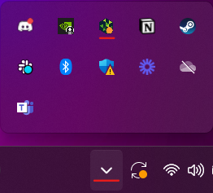
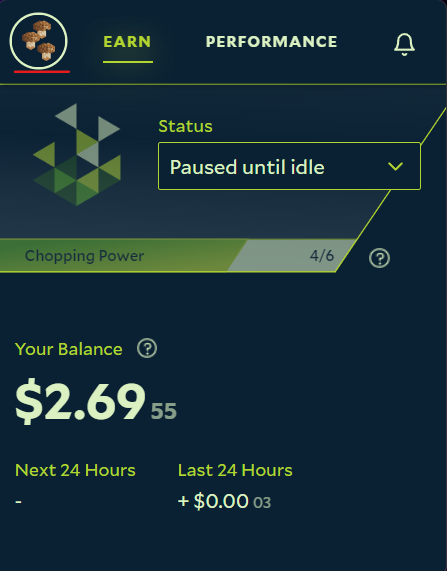
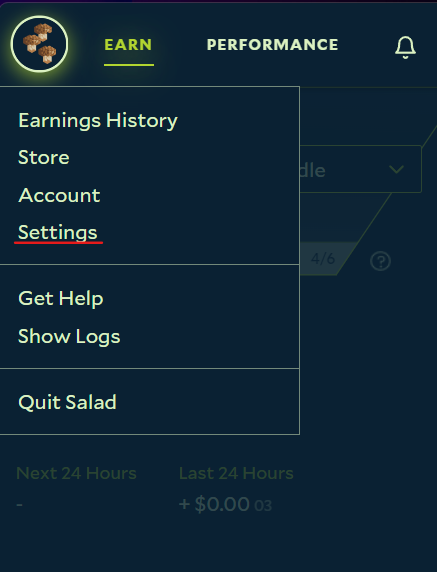
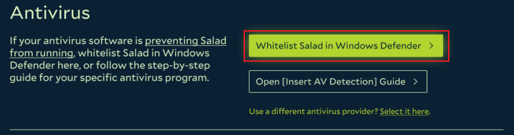
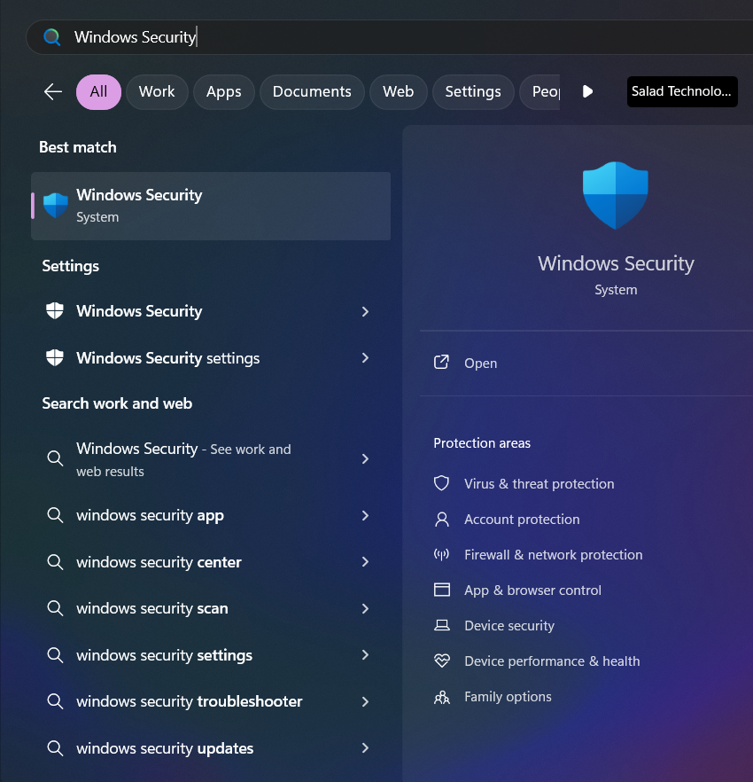
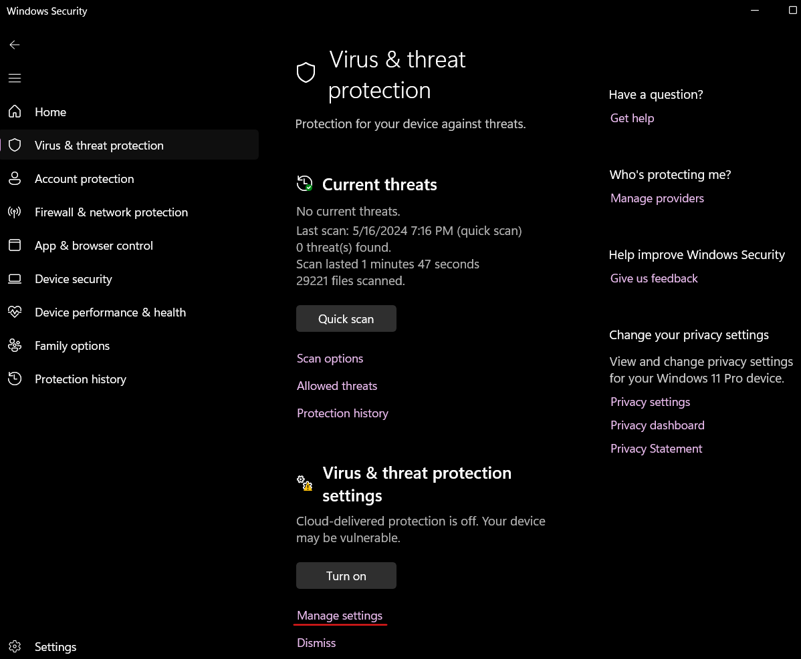
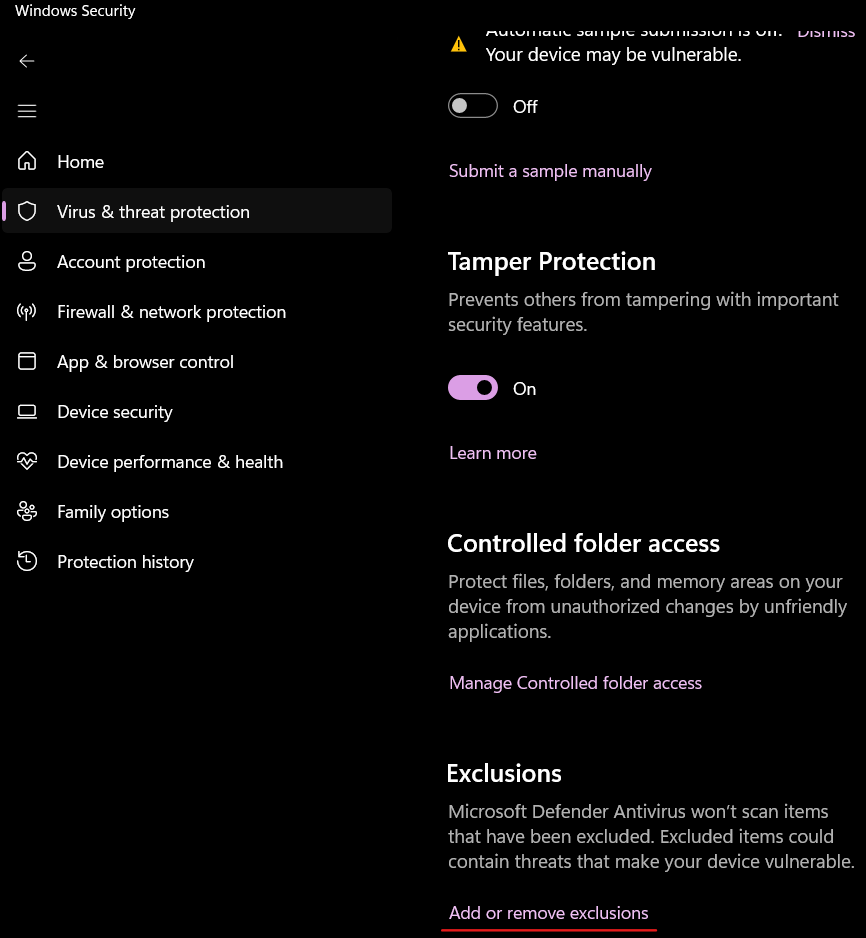
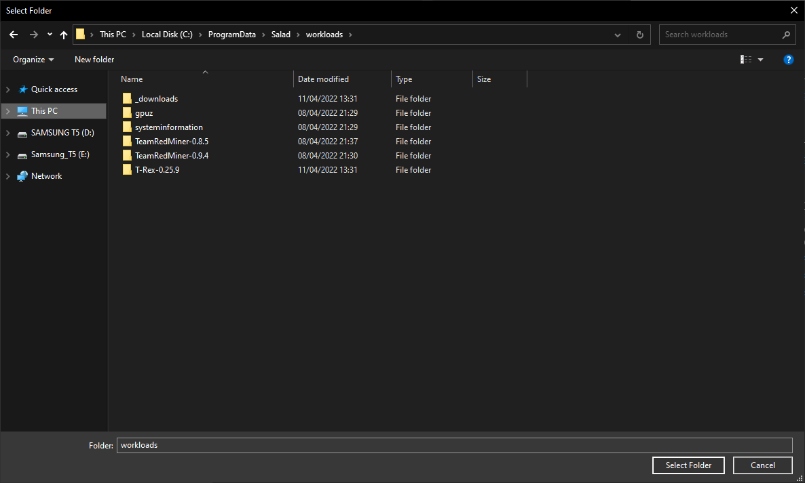

Even if you have disabled Windows Security/Defender, it may still be blocking Salad from getting your miners up and
running, and you'll need to add a whitelist as well.

You can also view a video walkthrough [here](https://vimeo.com/574423693).

# Whitelist Salad Using the Salad App:

1. Open your Salad Widget.

   

2. Click your Profile Picture at the top left.

   

3. Click the "Settings" button.

   

4. Click the "Whitelist Salad in Windows Defender" button at the top of the settings page.

   

5. Click "yes" on the Windows UAC prompt to allow Salad to automatically whitelist itself in Windows Security/Defender.
6. Click the Start button in Salad again to start Chopping.

---

# Manually Whitelisting Salad:

1. To find the Windows Defender settings, click on your Windows Icon and a search bar will appear. In that search bar,
   search "Windows Security"  and select "Windows Security".

   

2. After opening Windows Security, you will shown the main dashboard for Windows Security. From here, select Virus &amp;
   threat protection as selected in the screenshot below.
3. After you have clicked "Virus &amp; threat protection" setting on the left of the main screen. You will now be shown
   more settings related to virus and threat protection on your computer. From there select "Manage settings" under
   Virus &amp; threat protection settings as shown below.

   

4. From this page, scroll down all the way to the bottom, and select "Add or remove exclusions", as shown below.

   

5. After you have clicked on 'Add or remove exclusions", select "Add an exclusion", then select "Folder",  and navigate
   to the Salad folder by pasting "C:\\ProgramData\\Salad\\workloads" into the bar at the top that shows your filepath,
   as shown below.

   

6. Click Select Folder, and Salad has now been whitelisted! Open your Salad widget again to start Chopping.

---

## Defender removed a file from C:\ProgramData\Salad\workloads

Windows Defender sometimes quarantines one of Salad's miners (XMRig, Rigel, T-Rex and others) and reports it as a
"Trojan" or a "vulnerable driver". These are false positives: the miners are unmodified, well-known open-source programs
that most antivirus products flag simply because they mine. Your PC is not infected, but Salad cannot earn from mining
until the file is back. You have two choices:

- **Whitelist the folder.** Add `C:\ProgramData\Salad` as a folder exclusion using the steps above, then open **Virus &
  threat protection > Protection history**, find the quarantined item and choose **Restore** (or **Allow**). Restart
  Salad; it downloads the miner again if needed.
- **Turn mining off.** If you would rather not exclude miners, disable mining in the Salad app's
  [Settings](/guides/using-salad/salad-app-settings). Salad then only runs container jobs, which Defender does not flag.

Whitelisting does not weaken protection elsewhere on your PC; Defender keeps scanning every other folder.
