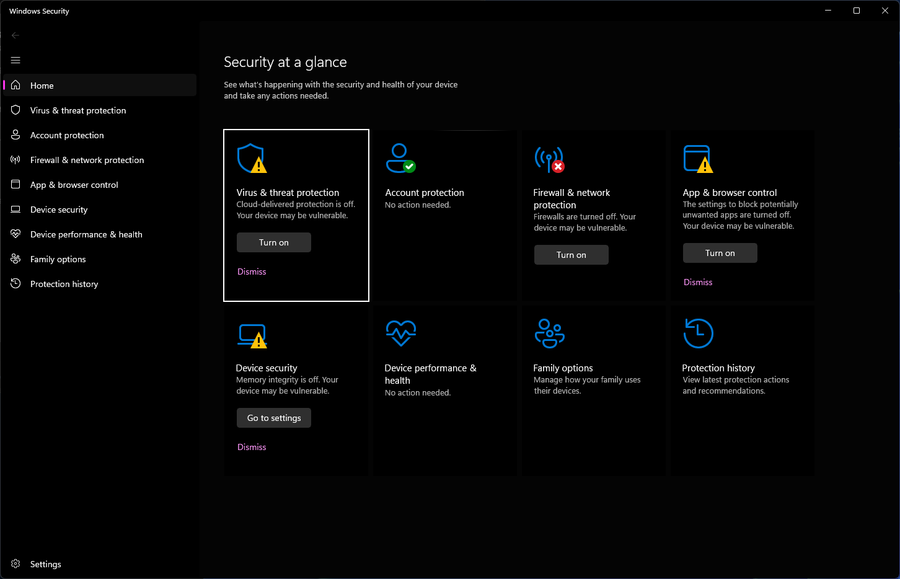
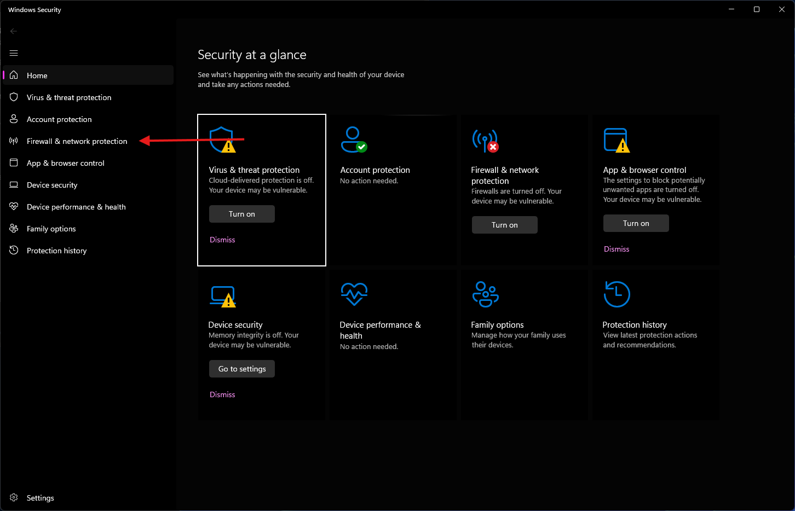
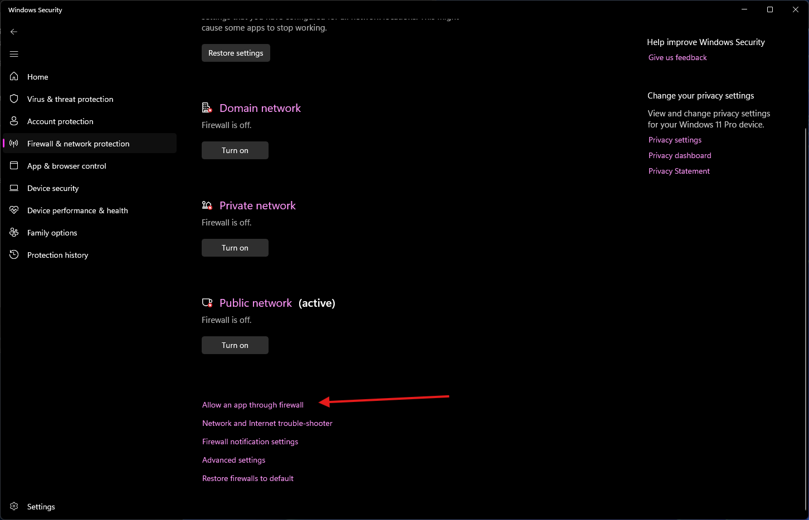
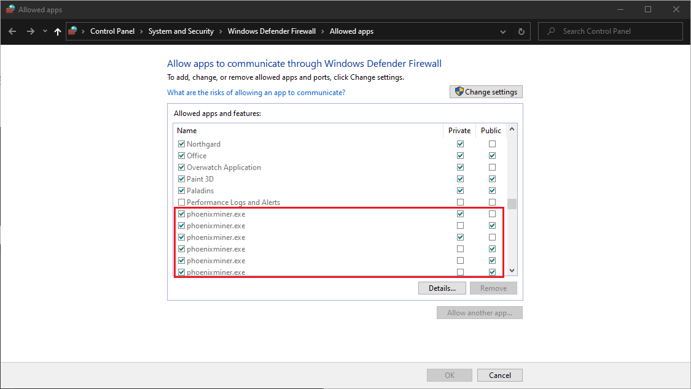

If a miner is listed in Windows Firewall but not allowed through, it cannot reach its pool and Salad reports no earnings
from mining. Allow it like this:

1. Open **Windows Security** from the Start menu.

   

2. Open **Firewall & network protection**.

   

3. Click **Allow an app through firewall**.

   

4. Click **Change settings**, then scroll to the affected miner (for example XMRig, Rigel or T-Rex).

   

5. Tick the box on the left of the miner and both **Private** and **Public** boxes on the right. If the same miner
   appears more than once, allow every entry. Click **OK**.

6. Start Salad again.

For a third-party or router firewall, see
[Whitelisting Salad in your firewall](/troubleshooting/antivirus/whitelisting-salad-in-your-firewall). If Windows
Defender is also removing the miner files, see
[How to whitelist Salad in Windows Defender](/troubleshooting/antivirus/how-to-whitelist-salad-in-windows-defender).
