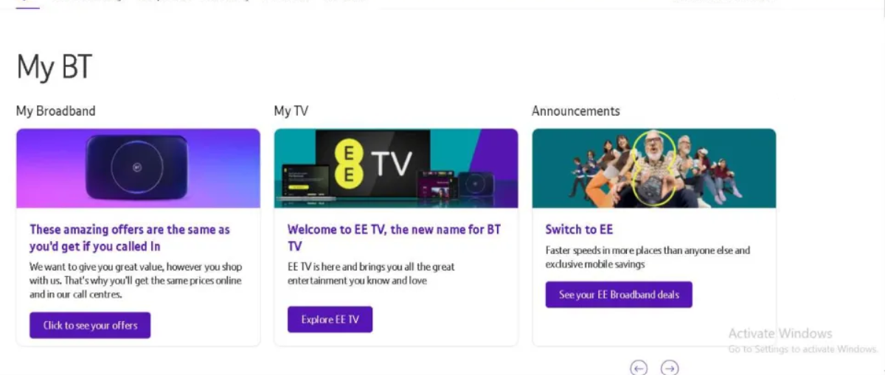
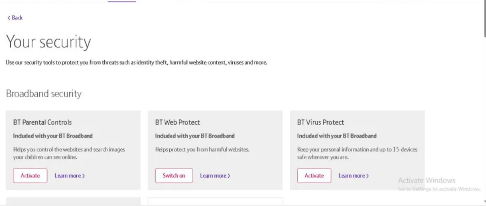

Some UK Chefs on BT broadband can't receive container or mining jobs because BT's optional security features block the
connections Salad needs. Two settings are involved; either one can be the cause.

### BT Virus Protect

BT Virus Protect is a free application that comes with all BT broadband packages. Chefs can either uninstall Virus
Protect entirely, or disable the Personal Firewall settings in the application. To disable Personal Firewall settings,
follow these steps.

1. Go to the [Your Security](https://my.bt.com/s/apps/appsmybt/#/packages?redirect=security) page on your BT account and
   login.

   

2. Locate the BT Web Protect section on the Security page.

   

3. Disable, or Switch Off BT's Web Protect feature.

### **BT Supplied Routers**

If you own a router, BT Smart Hub, provided by BT you can disable the router's firewall manually.

1. Type "192.168.1.254" into your browser's search bar.
2. Hit "Enter" to head to the Smart Hub dashboard.
3. Log in using your BT Broadband account credentials.
4. Navigate to "Advanced Settings" and then choose "Firewall".
5. Disable your firewall using the toggle on this screen.

After changing either setting, restart Salad and leave it running for 30 minutes. Still blocked? See
[How to unblock Salad with your ISP](/troubleshooting/connection-and-login/how-to-unblock-salad-with-your-isp) for DNS
options and what to ask BT.
