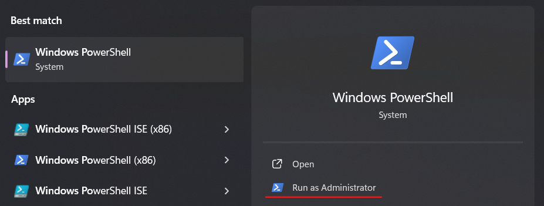

**What it means.** Before it can create its container environment, the Salad app checks that the modern version of
Windows Subsystem for Linux (WSL) is installed and then asks Windows to update it. This notification appears when that
check fails or the update doesn't complete. Until it passes, no container jobs are offered.

**Why it happens.** Most of the time it isn't an update problem at all. The app can't _see_ WSL, even when WSL works
fine for you, for one of these reasons - in order of how often we see them:

1. Windows 10 is using its older, built-in WSL. `wsl --update` says "the most recent version is already installed", but
   the separate WSL package that Salad needs was never installed.
2. The PC has no interactive desktop session: it's reached over Remote Desktop (RDP), or it rebooted and is sitting at
   the sign-in screen. The app can't run WSL commands without a desktop session.
3. The **Secondary Logon** Windows service is disabled (some "debloat" tools do this).
4. The WSL package is damaged ("The file cannot be accessed by the system").
5. Windows Update or the Microsoft Store is blocked, so `wsl --update` can't download anything.

## What to do

<Steps>
<Step>

### Check which WSL you have

Open PowerShell (no admin needed) and run:

```
wsl --version
```

If it prints a list of version numbers (WSL version, kernel version and so on), you have the modern WSL - skip to
step 3. If it prints usage text, an error, or nothing useful, you have the old built-in version - do step 2.

</Step>
<Step>

### Install the modern WSL package

Download the latest release's `.x64.msi` file from
[Microsoft's WSL releases page](https://github.com/microsoft/WSL/releases), run it, and reboot. Your other Linux
distributions are kept; this replaces the engine underneath them. After the reboot, `wsl --version` shows version
numbers, and Salad creates its environment on its own within a few minutes of starting.

If `wsl --update` fails with a download error (often a 403 on company or school networks), the same `.msi` download is
the workaround, or run `wsl --update --web-download`.

</Step>
<Step>

### Make sure Salad has a desktop session

Salad must run on a PC that is signed in to the Windows desktop. If you reach the PC remotely, use a mirroring tool
(Parsec, AnyDesk, Chrome Remote Desktop) rather than Windows Remote Desktop - see
[Using remote desktop with Salad](/guides/your-pc/using-remote-desktop-with-salad). If the PC runs unattended and
reboots for updates, set it to sign in automatically so it doesn't stop at the lock screen.

</Step>
<Step>

### Check the Secondary Logon service

Press **Win + R**, type `services.msc`, find **Secondary Logon**, and make sure its startup type is not _Disabled_ (set
it to _Manual_). Salad uses it to launch its helper programs; when it's disabled you'll also see "Problem detecting
hardware".

</Step>
<Step>

### Repair a damaged WSL package

If `wsl` commands print "The file cannot be accessed by the system" or similar: open **Settings > Apps > Installed
apps**, find **Windows Subsystem for Linux**, open **Advanced options** and click **Repair**, then **Reset** if needed.
If the entry isn't there, install the `.msi` from step 2.

</Step>
<Step>

### Run the update by hand and retry

In PowerShell **as Administrator**:

```
wsl --update
```

```
wsl --shutdown
```

Then click **Retry** on the notification or restart Salad, and leave it alone for 15-20 minutes. If you use a Windows
Update blocker, disable it for the update.

</Step>
</Steps>

<Callout type="warn" title="Don't try to create the environment yourself">
  `wsl --install -d salad-enterprise-linux` returns "distro not found": Salad's environment isn't in Microsoft's
  catalogue. The app imports it automatically once the WSL check passes. Reinstalling Salad doesn't change the WSL check
  either, so it's only worth trying after everything above.
</Callout>

## Still stuck?

Send [Salad Support](/contact) the output of `wsl --version` and `wsl -l -v`, whether the PC is reached remotely, and
your logs folder zipped ([how to find it](/guides/using-salad/how-to-find-your-salad-log-files)).


