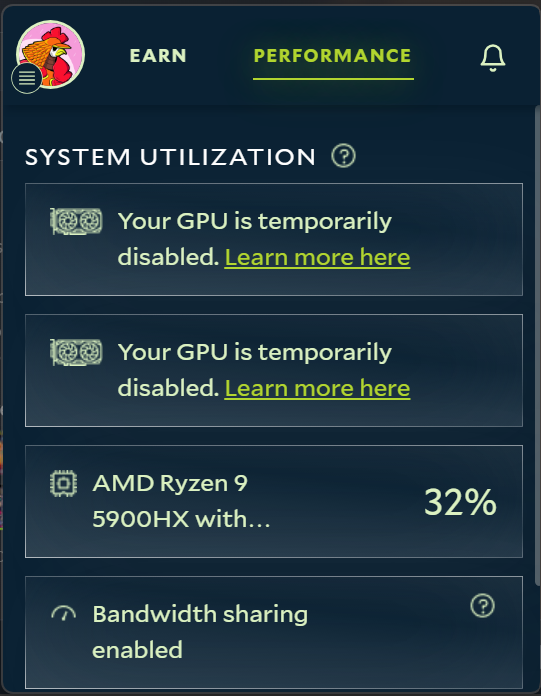

**What it means:** Salad is meant to Chop while you're away from the PC. Customers pay for your whole graphics card, so
when Salad detects a game or another intensive program using it, it pauses GPU workloads rather than let the job run
badly. You see a notification first, then a _temporarily disabled_ badge over your GPU on the Performance tab.

**What triggers it:** Anything that may be system-intensive:

- Games, including some launchers' background "pre-caching".
- Local AI tools (Ollama, LM Studio, Stable Diffusion UIs) and mining software outside Salad.
- Photo, video and 3D software (Adobe apps, DaVinci Resolve, Blender) and GPU-accelerated encoders such as OBS.
- Virtual Machine Software (VMWare, Virtualbox).
- Hardware-accelerated video playback at high resolution, and some overlays, wallpaper engines and monitoring tools.

## What happens next

When the notification appears you have about a minute to close the program. If it keeps running, Salad disables GPU
workloads for the rest of that Chopping session or until the program is closed; CPU and bandwidth workloads carry on.
The block is temporary: it ends when you stop Chopping or when the program ends.

## How to get the GPU back

<Steps>
<Step>

### Close the program

Quit it fully - tray icon > Exit - not just the window. Local AI tools in particular keep the model loaded in the
background; you can also close the program using Task Manager.

</Step>
<Step>

### Stop and restart Chopping

Salad should resume Chopping automatically - in the event it does not, follow these steps. In the Salad app, choose
**Stop** (or pause), wait a few seconds, then **Chop Now**. The badge clears and Salad runs its compatibility check
again before the next job.

</Step>
</Steps>

## Blocked while you were away?

Salad recognizes many GPU-heavy programs, some of which may run by services at programmed times. If you cannot find
which program is causing Salad to be disabled, contact [Salad Support](/contact) so we can review the detection.

## What about my privacy?

The detection run by Salad is done on your machine only - locally - Salad does not know your entire process list and
only gets an event when a specific intensive process matching our detection criteria is detected.

<Callout type="info" title="Why not just share the GPU?">
  Jobs need the whole card. Pausing quickly means the customer's job moves to a free machine instead of running slowly
  on yours, which keeps the network healthy and customers around for longer.
</Callout>
