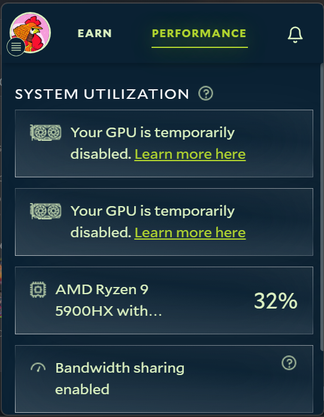

**What it means.** Salad is meant to Chop while you're away from the PC. Customers pay for your whole graphics card, so
when Salad detects a game or another intensive program using it, it pauses GPU workloads rather than let the job run
badly. You see a notification first, then a _temporarily disabled_ badge over your GPU on the Performance tab.

**What triggers it.** Anything that works the GPU hard:

- Games, including some launchers' background "pre-caching".
- Local AI tools (Ollama, LM Studio, Stable Diffusion UIs) and mining software outside Salad.
- Photo, video and 3D software (Adobe apps, DaVinci Resolve, Blender) and GPU-accelerated encoders such as OBS.
- Hardware-accelerated video playback at high resolution, and some overlays, wallpaper engines and monitoring tools.

## What happens next

When the notification appears you have about a minute to close the program. If it keeps running, Salad disables GPU
workloads for the rest of that Chopping session; CPU and bandwidth workloads carry on. The block is temporary: it ends
when you stop Chopping.

## How to get the GPU back

<Steps>
<Step>

### Close the program

Quit it fully - tray icon > Exit - not just the window. Local AI tools in particular keep the model loaded in the
background.

</Step>
<Step>

### Stop and restart Chopping

In the Salad app, choose **Stop** (or pause), wait a few seconds, then **Chop Now**. The badge clears and Salad runs its
compatibility check again before the next job.

</Step>
</Steps>

## Blocked while you were away?

Salad recognizes most GPU-heavy programs, but some trigger the block when they shouldn't. If it happens with nothing
open, take a screenshot of the notification and of Task Manager's **Processes** tab sorted by the **GPU** column, and
send both to [Salad Support](/contact) so we can review the detection.

<Callout type="info" title="Why not just share the GPU?">
  Jobs need the whole card. Pausing quickly means the customer's job moves to a free machine instead of running slowly
  on yours, which keeps the network healthy and keeps high-priority jobs coming your way.
</Callout>
