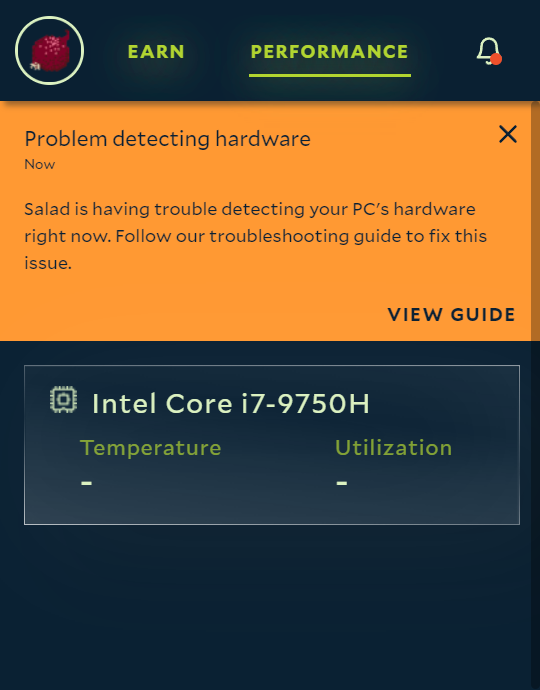

**What it means.** When Salad starts, it runs a small helper program that inventories your PC (CPU, GPU, memory, disks,
network) and reports it to the network. If that helper can't start, or starts and never finishes, the app shows this
notification and the machine isn't offered jobs. The GPU itself is usually detected fine by a separate check - this is
about the inventory.



**Why it happens.** In order of how often we see it:

1. The **Secondary Logon** Windows service is disabled, so the app can't launch its helper programs (often done by
   "debloat" or optimization tools).
2. **Windows' management layer (WMI / PowerShell) hangs** on a specific device query - Bluetooth adapters, network
   printers and unusual USB devices are the usual culprits - so the inventory never completes.
3. The **WMI repository is damaged** or PowerShell has been disabled or broken.
4. The PC has **no desktop session** (reached over Remote Desktop, or stuck at the sign-in screen).
5. A security product blocks the helper from running.

## What to do

<Steps>
<Step>

### Restart the PC

A plain restart clears a one-off hang. If the notification returns, continue.

</Step>
<Step>

### Check the Secondary Logon service

Press **Win + R**, type `services.msc`, find **Secondary Logon**, open it and set _Startup type_ to **Manual** if it is
_Disabled_. Start Salad again.

</Step>
<Step>

### Check PowerShell and WMI

Open PowerShell as Administrator and run `winmgmt /verifyrepository`. If it reports the repository is inconsistent, run
`winmgmt /salvagerepository`, reboot and verify again. If PowerShell itself won't open or has been disabled, see
[Re-enable PowerShell](/troubleshooting/pc-configuration/re-enable-powershell).

</Step>
<Step>

### Find a device query that hangs

In PowerShell, run these one at a time; each should finish within a few seconds:

```
Measure-Command { Get-CimInstance Win32_VideoController | Out-Null }
```

```
Measure-Command { Get-CimInstance Win32_PnPEntity | Out-Null }
```

```
Measure-Command { Get-Printer | Out-Null }
```

If one takes minutes or never returns, that device class is the problem. Unplug or disable the matching device
(Bluetooth dongle, network printer, odd USB device) as a test.

</Step>
<Step>

### Make sure Salad has a desktop session

Salad needs a signed-in Windows desktop. See
[Using remote desktop with Salad](/guides/your-pc/using-remote-desktop-with-salad) if you reach the PC remotely.

</Step>
<Step>

### Whitelist Salad in your security software

Add `C:\Program Files\Salad` and `C:\ProgramData\Salad` as exclusions: [Antivirus guides](/troubleshooting/antivirus).

</Step>
</Steps>

## Still stuck?

Send [Salad Support](/contact) which antivirus you use, the timings from step 4, whether the PC is accessed remotely,
and your logs folder zipped ([how to find it](/guides/using-salad/how-to-find-your-salad-log-files)).
