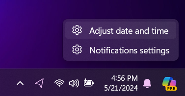
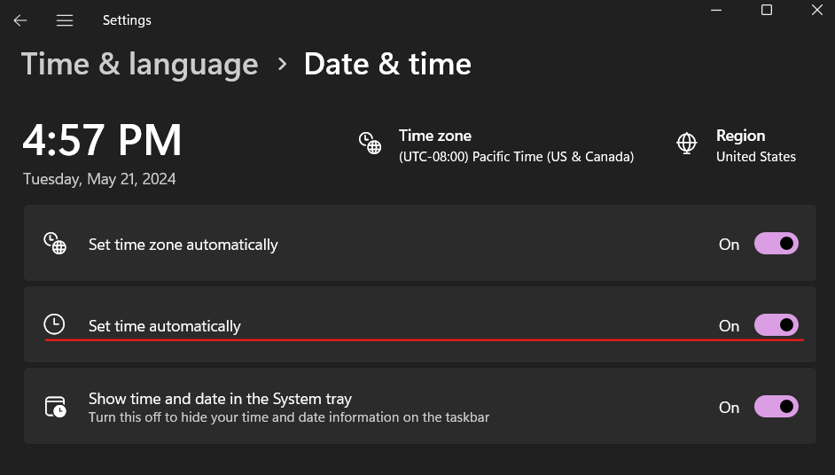
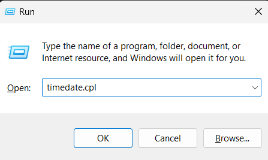
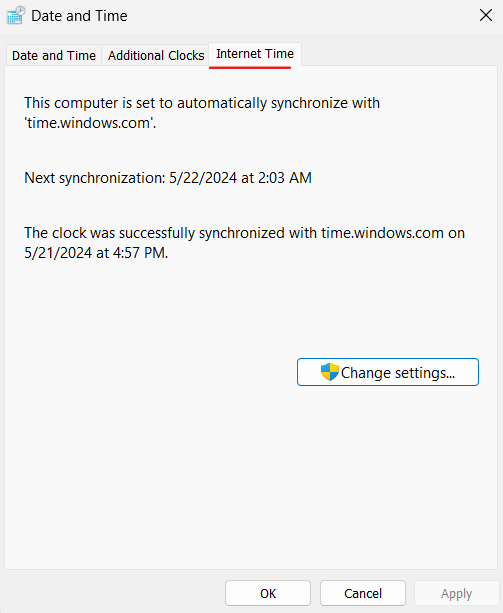
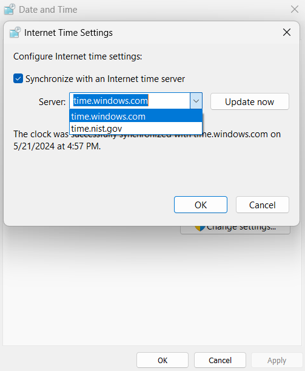

Salad's connections to its servers are signed with the current time. If your PC clock is off by more than a few minutes,
logins fail, the app shows connection or certificate errors, and jobs cannot be assigned. Check the clock in the taskbar
against your phone; if it is wrong, or the time zone is wrong, follow the steps below.

## Set time automatically

1. Right-click the clock in the taskbar and choose **Adjust date and time**.

   

2. Turn **Set time automatically** and **Set time zone automatically** on, and check that the time zone shown is yours.

   

## Force a sync with the internet time server

1. Press **Windows + R**, type `timedate.cpl` and press **Enter**.

   

2. Open the **Internet Time** tab and check when the clock last synchronized. Windows normally syncs about once a day.

   

3. If it has not synced recently or reports an error, click **Change settings**, pick another server from the list (for
   example `time.windows.com` or `time.nist.gov`) and click **Update now**.

   

Restart Salad after the clock is corrected. If the clock drifts again after every reboot, the motherboard's CMOS battery
is probably flat; it is a cheap coin cell that any PC shop can replace.
