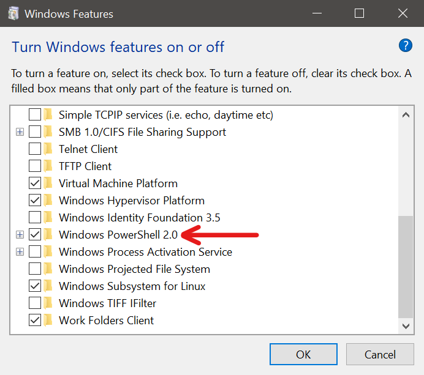
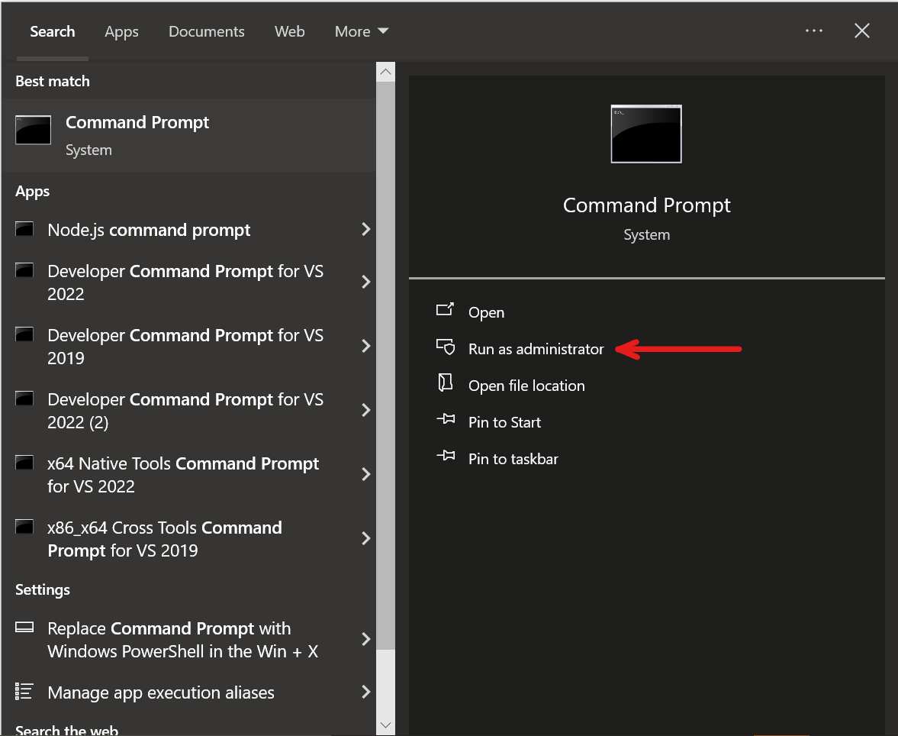

Salad runs PowerShell commands to read your hardware and prepare the container environment. When PowerShell is disabled,
blocked or corrupt, Salad shows **Problem detecting hardware** or a **storage calculation error**, and the logs show
PowerShell failing to start. See
[Problem detecting hardware](/troubleshooting/degraded-state/problem-detecting-hardware) and
[How to fix a storage calculation error](/troubleshooting/container-jobs/storage-calculation-error) for the full
troubleshooting of those messages; this page is the PowerShell fix.

## 1. Check that PowerShell opens

Press **Windows + R**, type `powershell` and press **Enter**. If a blue window opens and shows a prompt, PowerShell
itself works, and the problem is more likely an antivirus or policy blocking scripts: see
[Antivirus](/troubleshooting/antivirus). If it errors out or closes immediately, continue.

## 2. Toggle the PowerShell Windows feature

1. Search for **Turn Windows features on or off** in the Start menu, or press **Windows + R** and run
   `optionalfeatures.exe`.
2. Find **Windows PowerShell 2.0** and untick it.

   

3. Click **OK** and restart your PC.
4. Open the same window again, tick **Windows PowerShell 2.0**, click **OK** and restart once more.

## 3. Repair system files

If PowerShell still fails, run the System File Checker:

1. Open Command Prompt as administrator.

   

2. Run `sfc /scannow` and wait for it to finish, then reboot.

If SFC reports errors it could not fix, continue with the DISM commands on
[Restoring DISM](/troubleshooting/pc-configuration/restoring-dism).

## Still stuck?

Send [Salad Support](/contact) your machine ID, a screenshot of the notification and your zipped logs. See
[How to create a support ticket](/guides/your-pc/how-to-create-a-support-ticket).
