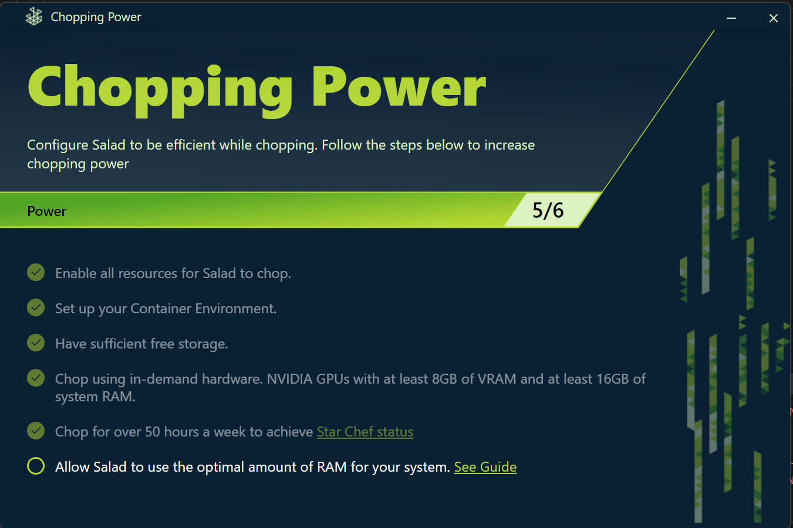
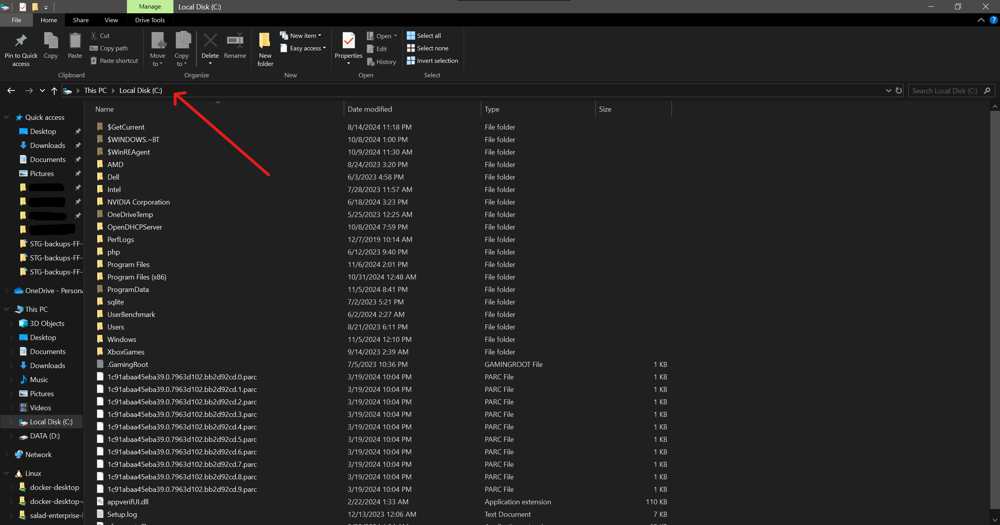
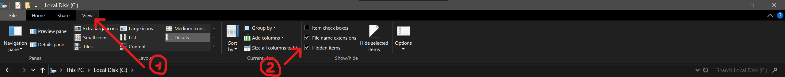
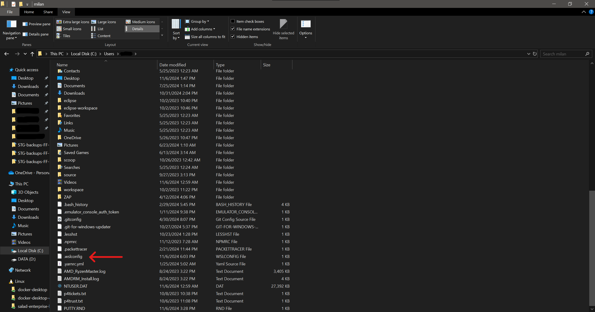
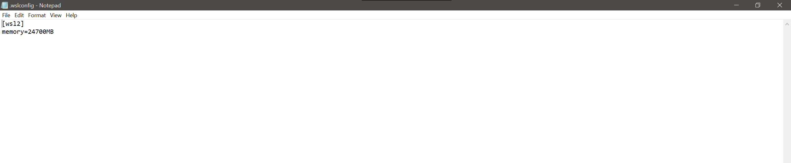
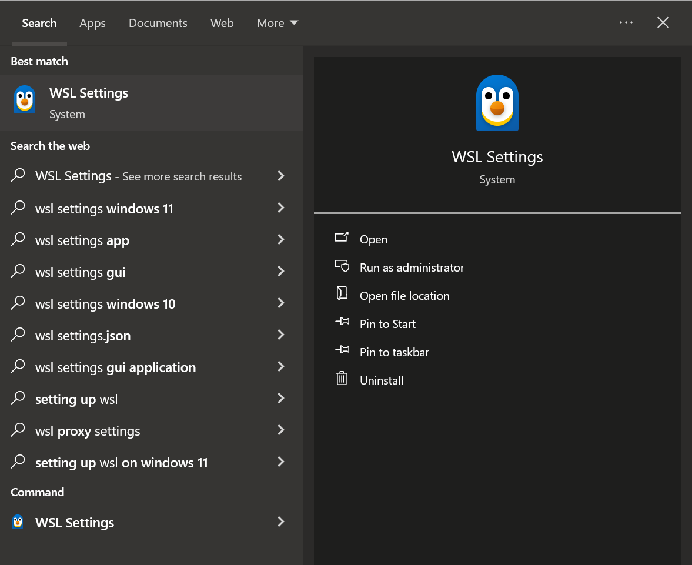
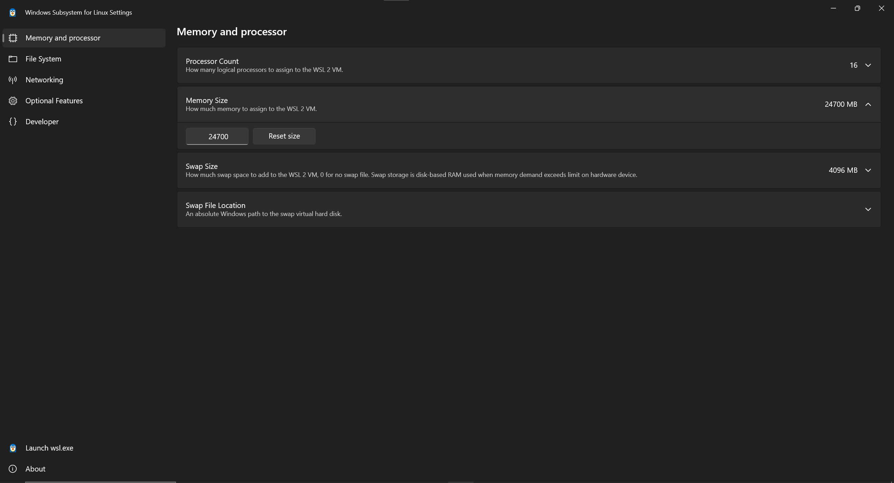

`.wslconfig` is a small text file in your user folder that configures WSL. Salad writes it when it sets up the container
environment, and the only thing Salad puts in it is the memory limit for the container environment, under a `[wsl2]`
header. Anything else in that file was added by you, by another program, or by a guide found online, and extra settings
are the usual cause of these symptoms:

- The container environment fails on every start, and the logs or notification mention **address already in use**. This
  is what a `networkingMode` or `kernelCommandLine` line does.
- Container jobs cannot reach the network while Windows is online.
- The Chopping Power bar is incomplete because the memory line was changed or removed.



## Fix: keep only what Salad wrote

1. Stop Salad.
2. Open File Explorer and click in the address bar at the top.

   

3. Type `%UserProfile%` and press **Enter**. If you do not see `.wslconfig`, turn on **View > Show > Hidden items**.

   

   

4. Open `.wslconfig` with Notepad. Delete every line except the `[wsl2]` header and the `memory=` line, so the file
   looks like this (your number will differ):

   

   ```
   [wsl2]
   memory=24700MB
   ```

   Do not add a `networkingMode` line, a `kernelCommandLine` line, or any other setting, whatever a forum post
   recommends. Leave the memory value as Salad set it; raising it does not earn more and can starve Windows.

5. Save the file, then open PowerShell and run `wsl --shutdown` so WSL reloads the configuration.
6. Start Salad.

If the memory line is missing or you are unsure what it was, delete the whole `.wslconfig` file, run `wsl --shutdown`,
and start Salad: it writes the file again when it prepares the container environment.

## The WSL Settings app

Recent WSL versions include a **WSL Settings** app (search for it in the Start menu). It edits the same `.wslconfig`
file. It is fine for checking the **Memory Size** value Salad set, but do not change networking or other settings in it;
any change there lands in `.wslconfig` and the fix above applies.





## Still stuck?

If the container environment still fails after restoring the file and rebooting, follow
[Failed to start container environment](/troubleshooting/degraded-state/failed-to-start-container-environment), then
send [Salad Support](/contact) your machine ID, a screenshot of the notification, your zipped logs and the contents of
your `.wslconfig`. See [How to create a support ticket](/guides/your-pc/how-to-create-a-support-ticket).
